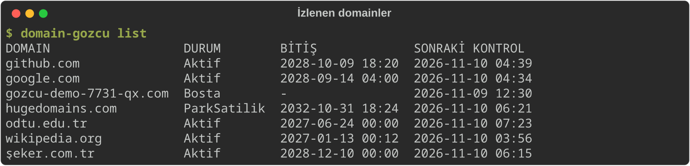
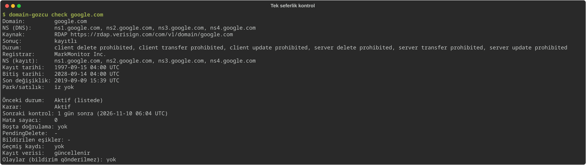
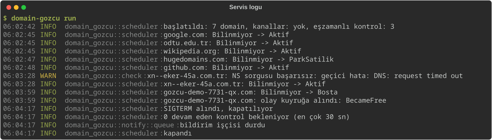
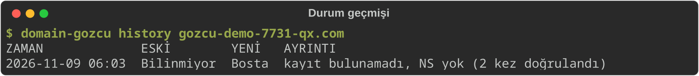
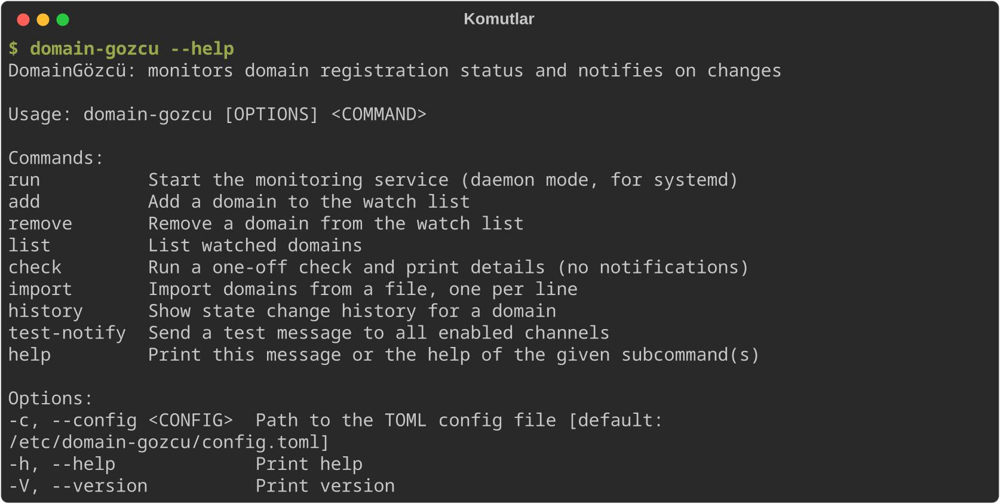

# DomainGözcü

7/24 çalışan, tek binary'lik bir **domain durum izleme** servisi. İzlediğin domainlerin kayıt durumunu (aktif, süresi dolmuş, redemption, pendingDelete, boşta, satılık...) periyodik olarak kontrol eder ve durum değişince **Discord** ve/veya **Telegram**'a bildirim gönderir.



> Ekran görüntüleri gerçek çıktılardır: demo bir veritabanında 7 domain ile çalıştırıldı (Kasım 2026). `gozcu-demo-7731-qx.com` kayıtsız bir test adıdır; `hugedomains.com` bir domain pazarının kendi sitesi olduğu için `ParkSatilik` görünür.

## Ne yapar, ne yapmaz

- Yapar: DNS / RDAP / WHOIS ile durum tespiti, değişiklikte bildirim, bitiş tarihi uyarıları, günlük özet, durum geçmişi.
- **Yapmaz: domain satın almaz, kaydetmez, yenilemez, hiçbir registrar/pazar yeri hesabına bağlanmaz.** Sadece izler ve haber verir. "Boşta" bildirimi geldiğinde kaydı sen kendin yaparsın.

## Nasıl tespit eder

Kontrol sırası: **DNS (NS) → RDAP → WHOIS (RDAP yoksa) → park/satılık tespiti** (yalnızca kayıtlı domainlerde: NS listesi, market alan adlarına yönlenme, sayfa metninde satılık ifadeleri).

- RDAP sunucusu IANA bootstrap'ten bulunur (`https://data.iana.org/rdap/dns.json`). Önbellek, veritabanının yanına `rdap-dns.json` olarak yazılır (varsayılan: `/var/lib/domain-gozcu/rdap-dns.json`).
- WHOIS sunucusu `whois.iana.org`'dan `refer:` ile bulunur.
- Durum RDAP/WHOIS **status kodlarından** çıkarılır; tarih tahminine dayanılmaz (tek istisna: pendingDelete düşme tarihi tahminidir).
- **"Boşta" çift doğrulamalıdır:** ilk "kayıt yok" sonucunda bildirim atılmaz, `bosta_dogrulama_dk` (varsayılan 2 dk) sonra tekrar bakılır; ikinci kontrol de aynıysa ve NS yoksa "boşta" olur ve bildirim gider.
- **Geçici hatalar (429, 5xx, timeout, ağ hatası) durumu asla değiştirmez.** Sadece backoff uygulanır; `ardisik_hata_uyarisi` kadar arka arkaya hata olursa bir kez "kontrol edilemiyor" bildirimi gider.

`check` komutu bu akışı tek bir domain için çalıştırır ve durum makinesinin vereceği kararı gösterir (veritabanına yazmaz, bildirim atmaz):



Servis çalışırken durum geçişleri loglanır. Aşağıdaki çalıştırmada kayıtsız domain ilk kontrolde değil, ~1 dk sonraki ikinci teyitte `Bosta` olmuştur; `şeker.com.tr`'deki (logda punycode: `xn--eker-45a.com.tr`) DNS zaman aşımı ise geçici hata olarak geçilmiş, durumu bozmamıştır:



Her geçiş geçmişe yazılır:



Ayrıntılı kurallar: `docs/TESPIT_KURALLARI.md`, mimari: `docs/MIMARI.md`.

## Durumlar ve varsayılan kontrol aralıkları

| Durum | Anlamı | Varsayılan aralık |
|---|---|---|
| `Aktif` | Kayıtlı, normal | 1440 dk (24 sa) |
| `ParkSatilik` | Kayıtlı ve park/satılık izi var | 1440 dk |
| `BitisYakin` | Bitişe eşik günden az kaldı | 720 dk (12 sa) |
| `SuresiDoldu` | Bitiş tarihi geçmiş (auto-renew grace dahil) | 360 dk (6 sa) |
| `Redemption` | redemption period | 60 dk |
| `PendingDelete` | pendingDelete, düşmek üzere | 10 dk |
| `Bosta` | Kayıt yok (2 kez doğrulandı) | 360 dk |
| `Askida` | client/server hold | 360 dk |
| `Bilinmiyor` | Henüz kontrol edilmedi / belirlenemedi | 30 dk |

Aralıklara `jitter_yuzde` (varsayılan ±%10) rastgelelik eklenir. Zamanlayıcı her 15 saniyede bir vakti gelenleri tarar.

## Derleme

```bash
cargo build --release
# binary: target/release/domain-gozcu
```

Binary glibc'ye dinamik bağlıdır; derlendiği dağıtımın glibc'sinden eski bir VDS'te çalışmayabilir. İsteğe bağlı statik (musl) derleme — **test edilmedi**:

```bash
rustup target add x86_64-unknown-linux-musl
# musl toolchain (ör. musl-gcc / musl-tools) kurulu olmalı
cargo build --release --target x86_64-unknown-linux-musl
```

Testler: `cargo test` (130 test; RDAP/WHOIS parser fixture'ları `tests/fixtures/` altında).

## VDS'e kurulum (systemd)

Servis, `domain-gozcu` adlı **statik sistem kullanıcısıyla** çalışır (`DynamicUser` kullanılmaz; sebep: CLI'nin aynı kullanıcıyla çalıştırılıp aynı veritabanına yazabilmesi, bkz. CLI bölümü). Aşağıdakiler root olarak çalıştırılır (`sudo`).

```bash
# 1) Kullanıcı ve dizinler
useradd --system --no-create-home --shell /usr/sbin/nologin domain-gozcu
install -d -m 0755 /etc/domain-gozcu
install -d -o domain-gozcu -g domain-gozcu -m 0750 /var/lib/domain-gozcu

# 2) Binary
install -m 0755 target/release/domain-gozcu /usr/local/bin/domain-gozcu

# 3) Config (gizli bilgi içermez; servis kullanıcısı okuyabilmeli)
install -m 0644 config.example.toml /etc/domain-gozcu/config.toml
$EDITOR /etc/domain-gozcu/config.toml

# 4) Gizli bilgiler (webhook / bot token) — sadece root okur
install -m 0600 -o root -g root deploy/domain-gozcu.env.example /etc/domain-gozcu/domain-gozcu.env
$EDITOR /etc/domain-gozcu/domain-gozcu.env

# 5) systemd unit
install -m 0644 deploy/domain-gozcu.service /etc/systemd/system/domain-gozcu.service
systemctl daemon-reload
systemctl enable --now domain-gozcu

# 6) Log
journalctl -u domain-gozcu -f
```

Notlar:

- `config.example.toml` varsayılan olarak Discord ve Telegram'ı `aktif = true` bırakır; gizli bilgiler yoksa **servis başlamaz** (config doğrulaması hata verir). Kullanmayacağın kanalı `aktif = false` yap veya env dosyasını doldur.
- Önce `domain-gozcu test-notify` ile bildirimleri doğrula (aşağıya bak), sonra `enable --now`.
- Unit sandbox'lıdır (`ProtectSystem=strict`, `NoNewPrivileges`, syscall filtresi vb.); yazma yalnızca `/var/lib/domain-gozcu` altındadır. Bu sertleştirme bu makinede kurulup çalıştırılarak test edilmedi (doğrulanmadı); ilk başlatmada `journalctl` çıktısına bak.
- Durdurma: `systemctl stop` SIGTERM gönderir; daemon uçuştaki işleri en fazla 30 sn bekler (`TimeoutStopSec=45`).
- Güncelleme: yeni binary'yi `install` ile kopyala, `systemctl restart domain-gozcu`.

## CLI kullanımı

```
domain-gozcu [-c|--config <dosya>] <komut>
```

`-c` varsayılanı `/etc/domain-gozcu/config.toml`; başka bir yol kullanıyorsan her komuta ekle (`-c` global bayraktır, komuttan önce veya sonra yazılabilir).

### CLI'yi hangi kullanıcıyla çalıştırmalı

CLI ve servis aynı SQLite veritabanını (WAL modu) paylaşır. Bu yüzden `add` / `remove` / `import` **servisi yeniden başlatmadan** etki eder. Ancak:

Veritabanı ve WAL dosyaları `domain-gozcu` kullanıcısına aittir (`UMask=0077`, mod 0600). Bu yüzden komutları bu kullanıcıyla çalıştır; root ile `add` yaparsan oluşan dosyalar root'a ait olabilir ve servis yazamaz hale gelir.

Webhook/token yalnızca `run` ve `test-notify` için gerekir. `add`, `remove`, `list`, `import`, `history`, `check` gizli bilgi olmadan çalışır, env dosyasına ihtiyaç duymaz:

```bash
sudo -u domain-gozcu domain-gozcu list
```

`import` için dosya `domain-gozcu` kullanıcısınca okunabilir olmalı (ev dizinleri genelde başka kullanıcılara kapalıdır; dosyayı ör. `/tmp` veya `/var/lib/domain-gozcu` altına koy).

`test-notify` veritabanına dokunmaz; env dosyasını yükleyip root olarak çalıştırabilirsin:

```bash
sudo sh -c 'set -a; . /etc/domain-gozcu/domain-gozcu.env; exec domain-gozcu test-notify'
```



### Komutlar

```bash
# Servisi başlatır (systemd bunu çağırır)
domain-gozcu -c /etc/domain-gozcu/config.toml run

# Domain ekle; --not ve --etiket (tekrarlanabilir) isteğe bağlı. IDN girdileri punycode'a çevrilir.
sudo -u domain-gozcu domain-gozcu add ornek.com
sudo -u domain-gozcu domain-gozcu add ornek.com --not "Düşerse haber ver" --etiket hedef --etiket kisa

# Domain sil
sudo -u domain-gozcu domain-gozcu remove ornek.com

# Listele; --durum ile duruma göre filtrele (Aktif, ParkSatilik, BitisYakin,
# SuresiDoldu, Redemption, PendingDelete, Bosta, Askida, Bilinmiyor)
sudo -u domain-gozcu domain-gozcu list
sudo -u domain-gozcu domain-gozcu list --durum PendingDelete

# Tek seferlik kontrol: ham sonucu ve durum makinesinin vereceği kararı yazdırır.
# Veritabanına yazmaz, bildirim göndermez.
sudo -u domain-gozcu domain-gozcu check ornek.com

# Dosyadan toplu ekle: satır başına bir domain; boş satırlar ve # ile başlayanlar atlanır
sudo -u domain-gozcu domain-gozcu import /var/lib/domain-gozcu/domainler.txt

# Durum geçmişi
sudo -u domain-gozcu domain-gozcu history ornek.com

# Etkin kanallara test mesajı gönderir (kuyruğu atlar); hata varsa çıkış kodu sıfırdan farklıdır
sudo sh -c 'set -a; . /etc/domain-gozcu/domain-gozcu.env; exec domain-gozcu test-notify'
```

`config.toml` içindeki `[[domain]]` girdileri her başlangıçta (ve CLI komutlarında) veritabanıyla eşitlenir.

## Yapılandırma referansı

Tüm bölümler ve anahtarlar isteğe bağlıdır; verilmeyenler aşağıdaki varsayılanları alır. Örnek dosya: `config.example.toml`.

### `[genel]`

| Anahtar | Varsayılan | Anlamı |
|---|---|---|
| `veritabani` | `/var/lib/domain-gozcu/gozcu.db` | SQLite dosyası. Üst dizin yoksa oluşturulmaya çalışılır. `rdap-dns.json` önbelleği aynı dizine yazılır. |
| `log_seviyesi` | `info` | `trace`/`debug`/`info`/`warn`/`error`. `RUST_LOG` ortam değişkeni verilirse o öncelik alır. |
| `eszamanli_kontrol` | `8` | Aynı anda kontrol edilen en fazla domain sayısı (> 0). |
| `sunucu_istek_per_sn` | `1` | Her RDAP/WHOIS sunucusuna saniyede en fazla istek sayısı (> 0). |
| `http_timeout_sn` | `10` | HTTP zaman aşımı, saniye (> 0). |
| `kullanici_ajani` | `DomainGozcu/1.0 (+kişisel izleme aracı)` | HTTP User-Agent. |

### `[zamanlama]` (dakika, hepsi > 0)

| Anahtar | Varsayılan |
|---|---|
| `aktif` | `1440` |
| `park_satilik` | `1440` |
| `bitis_yakin` | `720` |
| `suresi_doldu` | `360` |
| `redemption` | `60` |
| `pending_delete` | `10` |
| `bosta` | `360` |
| `askida` | `360` |
| `bilinmiyor` | `30` |
| `jitter_yuzde` | `10` (0-100; aralıklara ±% rastgelelik) |
| `bosta_dogrulama_dk` | `2` ("boşta" ikinci teyit bekleme süresi) |

### `[uyarilar]`

| Anahtar | Varsayılan | Anlamı |
|---|---|---|
| `bitis_esikleri_gun` | `[30, 7, 1]` | Bitişe bu kadar gün kalınca uyarı; her eşik aynı bitiş tarihi için bir kez bildirilir. |
| `pending_delete_gun` | `5` | pendingDelete düşme tahmini için gün sayısı. |
| `ardisik_hata_uyarisi` | `5` | Bu kadar ardışık hatada bir kez "kontrol edilemiyor" bildirimi. |
| `gunluk_ozet` | `true` | Günlük özet gönderilsin mi. |
| `gunluk_ozet_saat` | `"09:00"` | `SS:DD`; `saat_dilimi` saat dilimine göre. |
| `saat_dilimi` | `"Europe/Istanbul"` | IANA saat dilimi (özet zamanı ve mesajlardaki tarihler). |

`[uyarilar.uzanti_pending_delete_gun]` — uzantıya göre `pending_delete_gun` ezmesi, ör. `org = 5`. Varsayılan boş.

### `[bildirim.discord]`

| Anahtar | Varsayılan | Anlamı |
|---|---|---|
| `aktif` | `false` kodda; örnek dosyada `true` | Kanal açık mı. Açıksa webhook zorunlu. |
| `webhook_url` | boş | **Config'e yazma;** `DOMAIN_GOZCU_DISCORD_WEBHOOK` kullan (doluysa config'i ezer). |
| `bosta_mention` | boş kodda; örnekte `"@everyone"` | "Boşta" mesajına eklenen mention. Boş = mention yok. Rol için `"<@&ROL_ID>"`. |

### `[bildirim.telegram]`

| Anahtar | Varsayılan | Anlamı |
|---|---|---|
| `aktif` | `false` kodda; örnek dosyada `true` | Açıksa `bot_token` ve `chat_id` zorunlu. |
| `bot_token` | boş | **Config'e yazma;** `DOMAIN_GOZCU_TELEGRAM_TOKEN` kullan. |
| `chat_id` | yok | Metin olarak yazılır (`"123456789"`, grup için `"-100..."`). |

### `[tespit]` (liste değerleri verilirse varsayılanı **tamamen değiştirir**)

| Anahtar | Varsayılan | Anlamı |
|---|---|---|
| `park_ns` | `sedoparking.com`, `dan.com`, `afternic.com`, `bodis.com`, `parkingcrew.net`, `above.com`, `parklogic.com`, `domainmarket.com` | NS'in sonu bunlardan biriyle bitiyorsa park sayılır. |
| `market_alanlari` | `dan.com`, `sedo.com`, `afternic.com`, `atom.com`, `hugedomains.com` | Site bu alanlara yönleniyorsa satılık sayılır. |
| `satilik_ifadeleri` | `this domain is for sale`, `domain is for sale`, `buy this domain`, `make an offer`, `bu alan adı satılıktır`, `bu domain satılık`, `alan adı satılık` | Sayfa metninde (büyük/küçük harf duyarsız) aranır. |
| `whois_bulunamadi_ifadeleri` | `no match`, `not found`, `no data found`, `is available`, `no entries found` | WHOIS yanıtında bulunursa "kayıt yok" sayılır. |

### `[[domain]]` (başlangıç listesi, isteğe bağlı)

```toml
[[domain]]
ad = "ornek.com"
not = "Düşerse haber ver"
etiket = ["hedef"]
```

`ad` zorunlu (geçerli domain olmalı), `not` ve `etiket` isteğe bağlı. CLI'daki `add` ile eşdeğerdir.

## Bildirimler

| Olay | Mesaj başlığı |
|---|---|
| Boşta (2 kez doğrulandı) | 🟢 `ornek.com BOŞTA görünüyor.` (yüksek öncelik, `bosta_mention` eklenir) |
| pendingDelete | 🔴 `pendingDelete!` + tahmini düşme tarihi |
| Redemption'a girdi | 🟠 `redemption dönemine girdi.` |
| Satılık/park | 🟣 `satılık görünüyor.` |
| Diğer durum değişimleri | durum emojisiyle `durumu değişti: X → Y.` (🔵 Aktif, 🟡 BitisYakin, 🟠 SuresiDoldu/Redemption, ⚫ Askida, ⚪ Bilinmiyor) |
| Bitiş uyarısı | ⏳ `bitişine N gün kaldı.` |
| Yenilendi | 🔄 `yenilendi.` + yeni bitiş |
| Başkası aldı | ⚪ `tekrar alındı.` + yeni registrar |
| Kontrol edilemiyor | ⚠️ `kontrol edilemiyor.` (`ardisik_hata_uyarisi` sonrası) |
| Günlük özet | 📋 `Günlük özet — YYYY-AA-GG`: durum sayıları, dikkat gerektirenler, yakında bitenler |

- Bildirimler önce SQLite kuyruğuna yazılır, ayrı bir işçi gönderir; servis yeniden başlasa da kaybolmaz.
- Gönderim başarısızsa üstel backoff ile tekrar denenir: `30 sn × 2^deneme`, en çok 1 saat, ±%20 jitter. HTTP 429 alınırsa sunucunun `Retry-After` süresi beklenir (deneme sayılmaz).
- Günlük özet `gunluk_ozet_saat` / `saat_dilimi` ile belirlenen saatte gider; `gunluk_ozet = false` ile kapatılır.
- `bosta_mention` yalnızca Discord'da ve yalnızca "boşta" mesajında kullanılır; kapatmak için `""` yaz.

### Discord webhook nasıl alınır

1. Sunucu Ayarları → **Entegrasyonlar** (Integrations) → **Webhooklar** → **Yeni Webhook**.
2. Kanalı seç, istersen adını ver.
3. **Webhook URL'sini Kopyala**.
4. URL'yi `/etc/domain-gozcu/domain-gozcu.env` içine `DOMAIN_GOZCU_DISCORD_WEBHOOK=...` olarak yaz (config'e değil).

### Telegram bot token ve chat_id nasıl alınır

1. Telegram'da **@BotFather** ile konuş, `/newbot` yaz, ad ve kullanıcı adı ver; verdiği token'ı kopyala.
2. Token'ı env dosyasına `DOMAIN_GOZCU_TELEGRAM_TOKEN=...` olarak yaz.
3. Oluşturduğun bota Telegram'dan bir mesaj gönder (grup kullanacaksan botu gruba ekle ve grupta bir mesaj yaz).
4. Tarayıcıda `https://api.telegram.org/bot<TOKEN>/getUpdates` adresini aç (`<TOKEN>` yerine kendi token'ın); yanıttaki `message.chat.id` değeri `chat_id`'dir.
5. Bireysel sohbet id'leri pozitif, **grup/süper grup id'leri negatiftir** (ör. `-1001234567890`). Config'e metin olarak yaz: `chat_id = "-1001234567890"`.

**Gizli bilgiler (webhook URL'si, bot token) yalnızca env dosyasında durur; config'e, repoya veya loglara yazma.**

### Doğrulama

```bash
sudo sh -c 'set -a; . /etc/domain-gozcu/domain-gozcu.env; exec domain-gozcu test-notify'
```

Her etkin kanal için `✅ kanal: gönderildi (HTTP ...)` veya `❌ kanal: hata` yazar.

## Bilinen sınırlar ve registry notları

Aşağıdaki davranışlar registry'ye göre değiştiği için kesin varsayılmamalı; mümkün olanlar config'den ayarlanır.

- `.tr`: WHOIS (`whois.trabis.gov.tr`, IANA referral ile) çalışır; ancak registrar ve son değişiklik tarihi parse edilmez.
- Özel WHOIS sorgu sözdizimi isteyen uzantılar (ör. DENIC `.de`) desteklenmez.
- WHOIS "kayıt yok" ifadeleri registry'ye göre farklıdır; yeni uzantıda yanlış sonuç görürsen `[tespit].whois_bulunamadi_ifadeleri` listesini gerçek çıktıya göre güncelle.
- Park NS listesi ve satılık ifadeleri **başlangıç listeleridir**; gerçek domainlerle doğrulayıp güncelle. `domaincontrol.com` gibi genel NS'ler bilerek park sayılmaz.
- Pazar yeri sitelerinin kendisi (ör. `dan.com`) `ParkSatilik` olarak görünür.
- `Retry-After` başlığının HTTP-date biçimi desteklenmez; yalnızca saniye cinsinden değer okunur.
- pendingDelete düşme tarihi bir **tahmindir** (`pending_delete_gun`, uzantıya göre ezilebilir); registry'nin gerçek silme anı değişebilir.
- RDAP/WHOIS sunucuları hız sınırlar; `sunucu_istek_per_sn` varsayılanı (1) bilerek düşüktür.
- Bellek (ölçüldü): release build, veritabanında 1000 domain ve 30 eşzamanlı canlı kontrolle tepe RSS 17,9 MB (hedef < 30 MB).
